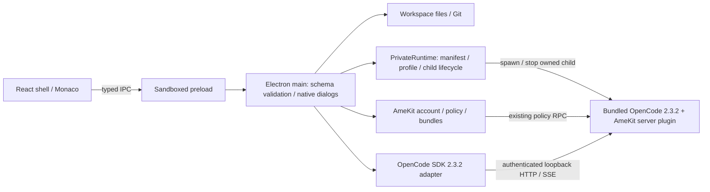

# Architecture and acceptance gates

## Boundaries

- `apps/desktop`: trusted main, minimal preload, untrusted browser renderer.
- `packages/protocol`: shared request/result/event types; no Node implementation exported to UI.
- `packages/ide-core`: canonical workspace boundary, UTF-8 revision saves, Git actions, recursive native watcher.
- `packages/opencode-adapter`: upstream v2 SDK, session/project ownership, SSE delta assembly and reconnect invalidation; `PrivateRuntime` validates bundled executable hash/version, isolates global config/data/cache/state, owns startup/readiness/auth/shutdown.
- `packages/amekit-server`: extracted server policy and model gateway, built as a bundled OpenCode plugin; shares model-policy with Account services.
- `packages/amekit`: standalone extracted Account and agents/skills services; no Solid GUI, pet, or desktop host dependency.
- `packages/ui`: local prototype-derived tokens and responsive shell styles.

Renderer gets no general filesystem/process/shell API. Main validates IPC tuples and main-frame ownership, denies window-open/navigation, and prompts before commit, delete, discard and non-dry-run replacement (after a preview count). Stage/unstage do not require confirmation. Explorer reveal validates canonical workspace containment before calling the OS shell. Account/bundle operations have their own allowlist and native confirmation. Git metadata and symlink escapes cannot be edited through workspace methods. SCM requires the selected folder to be the Git root. Existing Git hooks are deliberately disabled for IDE commits; repository filters/config are still Git-owned behavior, so open only trusted checkouts.

Model prompts require a current AmeKit Account policy and provider `amecode`. Auth headers/provider keys never appear in bridge payloads. Endpoint changes clear account state/policy before attaching a different local service. The app configures its bundled server plugin only in its private userData/backend profile; it never edits external/global OpenCode settings or uses shared-daemon service start/stop commands. Automatic startup waits for version and plugin RPC readiness, not merely an open port. Single-instance locking avoids competing IDE authorities. Concurrent startup requests share one child; startup errors fail closed with an explicit retry action. Advanced external connections remain opt-in and require an owner-enabled compatible plugin. Normal quit disposes Account/policy and SDK before stopping the owned backend; forced parent termination/crash cleanup is not guaranteed. See [Account details](../packages/amekit/docs/amekit.md).

## Automatic remote Pairing

`RemotePairing` owns an isolated `@opentunnel/client` identity under userData/remote-access and a random `ame-…` route per attachment; it does not call shared OpenCode service commands or touch global OpenTunnel identities. An explicit native confirmation precedes first enable. The SDK provisions certificates, attaches and reconnects its encrypted bridge; TLS terminates inside the main process. A bounded 3-minute setup runs outside the authority queue so disable/quit can abort it. Fatal failures close the route and gateway; generation guards reject late readiness/code results after disable or endpoint changes.

`PairingHost` binds an ephemeral loopback port, forwards native client authentication/streams/upgrades without injecting master credentials, and requests QR codes directly with private backend auth. IPC accepts only enabled/keepScreenActive preferences; the renderer never controls tunnel destinations. Pairing UI is three controls plus a focused QR dialog, countdown, refresh/copy and stale-request guards. Device tokens survive disable/re-enable in a single backend lifetime but are invalidated by the private backend password rotation on app restart. Existing manual tunnel settings migrate disabled rather than implicitly consenting to new public provisioning. The app persists no QR/device tokens; OpenTunnel credentials stay in its private main-only storage.

Focused tests cover ephemeral ports, idempotent screen settings, cancellation/late attachments and fatal-close behavior. Desktop smoke provisions a real external tunnel, redeems a one-time native code through HTTPS, checks unauthenticated rejection/token auth and persisted disable, then removes its temporary tunnel identity. Physical Android remains a manual acceptance gate.

## State and consistency

Project IDs/directories persist under Electron userData. UI stores layout/theme and tab/session metadata, not source buffers or credentials. File saves compare SHA-256 revision, serialize local writes, and reject stale content. Native watcher invalidates files and Git data. External writers are not locked; no crash recovery journal is implemented.

SSE is live-only. On each `server.connected` the adapter discards speculative deltas and requests API history refresh; stream failures use bounded exponential backoff until disposal. History is currently capped at 200 recent messages. Chat content is rendered as text, not raw HTML. Permission decisions bind to project-owned sessions.

## Session changes versus Git

The composer context chip and Session Changes panel use OpenCode's recorded session snapshots through the generated Promise client's `session.diff`, never the workspace Git change count or `vcs.diff`. Since an unbounded diff means only the latest turn in 2.3.2, the adapter first queries the earliest/latest user-message IDs (`type=user`, `limit=1`, ascending/descending) and sends both range bounds. No prompts returns an empty list. Ownership is checked before every diff; server range/location errors remain errors and never fall back to Git. The inspector's Git Diff panel still compares working files with HEAD independently.

After each completed execution, the timeline's native `snapshot.files`/`idle` projection shows a per-turn summary. Steered prompts keep the original execution opener. Expanding it lazily requests `session.diff({ sessionID, from })`; successful finished-turn results are retained while that row is mounted. History remains limited to 200 messages: executions whose opener is outside the loaded page or lacks a native idle marker do not get a fabricated summary. Whole-session review is not restricted by that history window.

Patch normalization is ported from the pinned OpenCode session UI and rendered using its `@pierre/diffs@1.6.1` dependency. No local HEAD/file reconstruction is used. Binary/empty patches and server truncation are explicitly labelled. Loading/errors/retry are distinct from an empty session. Project/session-scoped requests ignore disposed results; matching SSE events and reconnect invalidate the whole-session review.

## Agent Map

The composer and Agents drawer open a read-only Agent Map for the selected session's complete known family, including ancestors when opened from a nested session. Main validates project/session IDs; the adapter checks ownership, follows session-list cursors, then fetches the latest 200 messages per selected session with six concurrent requests and a 15-second timeout per request. The cycle-safe map is capped at 200 nodes; truncation and incomplete message history remain explicit rather than fabricated as complete data.

A pure adapter projection combines native agent/model/status/outcome, session token totals (falling back to assistant messages), prompts, latest output, skills and tool activity. Running text overlays come from the existing SSE cache. The renderer's pure tree model and SSR-safe message rendering support deterministic tests. The modal refreshes on matching project events with a 250 ms debounce and polls every 2.5 seconds only while agents are running; the closed composer badge uses the existing session list without additional map requests. Detail navigation exposes parent/child links, workspace file links, copy, open-session and native cancel actions. Escape returns from detail to map, then closes the modal.

## Native nested execution

The private OpenCode config sets `experimental.subagent_depth: 3`: root depth 0 plus three descendant generations. The native `subagent` tool enforces the boundary before creating depth 4; agent mode, model inheritance and permissions remain OpenCode-owned. AmeKit is embedded in core Settings and bundles remain native project agents/skills, not an extension-host dependency.

OpenCode owns background jobs and synthetic completion delivery into the parent inbox, including automatic parent wake-up. The IDE does not replace these with a custom scheduler or fabricate completion messages. A parent outcome is not a whole-tree outcome: independently running descendants remain visible and counted. The adapter follows all session-list cursors, retains parentID/agent/outcome and derives activity from native busy/idle timestamps. Agents panel renders that actual hierarchy and opens child histories; composer agent catalog is separate.

The renderer follows the current four-pane [HTML reference](../../agy-html/index.html): Projects & Chats rail, independent sticky Project Inspector, Chat Canvas and File/Diff/Artifact Stage. Three resizers and pane visibility persist independently. Chat-scoped corner drawers host the native session tree without replacing the editor. The bottom terminal uses the published xterm.js renderer and FitAddon with Microsoft's node-pty, rather than copying VS Code Workbench services or implementing an emulator. PTYs live in main; sandboxed renderer access is limited to validated terminal IPC (profiles/list/create/snapshot/write/resize/close). Creation resolves cwd from a registered project and profile from a main-owned allowlist; no arbitrary executable/cwd is accepted. Shells inherit the user's environment except internal Ame/Electron/OpenCode server variables and Node startup overrides. Explicit creation executes user shell startup files and subsequent commands with the user's OS permissions: this is not an execution sandbox. Windows uses PowerShell/CMD and ConPTY; macOS uses the user's shell or system zsh/bash with login initialization. Upstream native files are unpacked from ASAR for packaging. At most 20 sessions are retained, with 1 MiB of output characters per session; snapshots plus sequenced events restore tabs after renderer reload. Hidden panels retain processes; window close, renderer crash and normal app quit dispose owned PTYs, including macOS's last-window-close path. Sessions do not survive app exit; forced crash cleanup and termination of detached child processes are not guaranteed.

Explorer CRUD, backend search/replace and advanced Git operations delegate through Workspaces to the reviewed filesystem/search/git-ops modules. Successful mutations emit file invalidations. Explorer naming and branch creation use inline forms, never browser prompts; rename remaps tabs and dirty buffers for descendants, while deletion closes them. Explorer entries use the same slash-normalized path identity as CRUD and search results, including on Windows. Git supports branches, bulk staging, discard and HEAD diff with a Split/Inline toggle; Monaco's automatic narrow-panel inline fallback is disabled so the selected Split mode remains genuinely side-by-side.

Project Search uses a debounced, stale-result-guarded typed searchProject IPC, not per-file renderer reads. Include/exclude globs, text/case/whole-word/regex and the default 5,000-file / 1,000-match limits are shared with replacement. Ripgrep accelerates discovery when available, with node fallback and identical JS matching semantics; binary files, generated directories and text over 2 MiB are skipped. Replace preview is read-only; real replacement requires a native confirmation count and refreshes open buffers through the watcher (dirty buffers become conflicts rather than being overwritten). Search results carry line/column navigation, and Chat file chips use the same nonce-bearing, project/path-scoped Monaco navigation target. Artifact and /btw APIs remain unavailable and are labelled accordingly.

File and Diff tabs remember selection independently; closing a tab selects within its own mode. Save shortcuts apply only to a visible Code panel, never to a hidden buffer while viewing Diff or Artifact. Chat drawers do not hide the editor or disable its save shortcut. Retained Monaco diff models are released only after child editor teardown. Legacy stage-tool preferences migrate to the new layout without discarding file/session metadata.

## Verification contract

- Workspace tests: persistent project restoration, revisions/conflicts, concurrent saves, boundaries, UTF-8/binary limits, junction escapes, real Git initial/change/delete diff and stage/unstage/commit.
- Adapter tests: real generated SDK HTTP requests against controlled responses, auth containment, ownership checks, stream delta rendering and reconnect resync; no model charges.
- AmeKit tests: model-policy enforcement, safe vault behavior and filesystem bundle lifecycle; see test output for exact covered paths.
- Session-change regressions: generated SDK range/error tests and scoped renderer refresh/parser tests; `test/session-diff.test.ts` runs the staged native backend with an isolated profile/project and scripted loopback model. Two real native write-tool executions verify whole-session and per-turn snapshot patches exclude pre-existing Git edits, plus latest-turn default and empty-session behavior. This does not use or validate an external provider.
- Renderer state tests: persistent metadata and editor/layout transitions where present.
- Terminal: platform-profile unit tests and mocked project/lifecycle boundaries; `npm run test:terminal` builds then checks real Electron PTY input, ANSI color rendering, resize, interrupt, tabs/reload and owned-shell cleanup. Both development and unpacked Windows x64 app have passed; macOS runtime/packaging remain untested on actual hardware. The focused smoke does not provision Pairing or call external Account/model services.
- Runtime integration: real staged executable and plugin copied outside the workspace, isolated profile, concurrent startup, unauthorized HTTP rejection, signed-out policy, project agent discovery, session persistence across restart and owned shutdown; no development node_modules required by these copied resources.
- Desktop smoke: actual Electron build, isolated temporary userData/project, automatic backend connection/auth/policy/session/retry/shutdown plus CDP assertions for secure bridge, renderer, Monaco typing/save shortcut, disk persistence/conflict and theme/Inspector restore. It must not log into a real Account or prompt a model. Set `AME_IDE_PACKAGED_EXECUTABLE` to validate the packaged app with the same script.

On Windows, `npm run typecheck`, build, all 46 tests without skips with `node --import tsx --test --test-concurrency=1 test/*.test.ts packages/amekit/test/*.test.ts apps/desktop/src/renderer/test/*.test.ts`, and the current four-pane packaged `release-mockup/win-unpacked` smoke with automatic Pairing have passed. The default concurrent `npm test` currently intermittently fails the runtime plugin-active assertion; the isolated runtime suite and full sequential suite pass. The previous `release-integrated` is retained because its application was running. Current smoke checks exact 1440×900 pane/header/composer/terminal geometry against the reference, 1100px overflow, context-chip navigation (updated to Session Changes; the earlier smoke used Git Diff), three resizers, sticky Inspector, real project search and chat-local drawer bounds. `AME_IDE_SMOKE_SCREENSHOT` optionally captures a native Electron PNG; geometry assertions alone are not pixel-perfect visual certification. The native nesting integration test uses the real bundled scheduler/tools/inbox with a scripted loopback model, verifies depths 0–3, rejects creation of depth 4 and aggregates final receipts through every parent. It does not verify real-provider model behavior. Desktop smoke includes real parentID tree selection, File/Diff tab transitions and hidden-buffer save protection. A version-guarded Vite transform attaches Monaco's native unexpected-error handler to the three dropped WordHighlighter timer promises in 0.55.1. Expected cancellation is handled at the source, highlighting remains enabled, and no renderer/worker errors are filtered from smoke. Focused tests guard both the transformation and changed-upstream failure. Packaged MIT/third-party notices have been checked. Windows packaging is unsigned with executable editing/signing disabled; release signing must preserve the bundled runtime manifest hash. This does not validate the external manual gates below.

Remaining manual gates: authorized real Account login/refresh/logout, provider inference and agent filesystem edits, real agents/skills server discovery, publish/activate using a test account, Windows installer/signing, macOS runtime/package signing, large-workspace soak, mobile API compatibility. No fixture test substitutes for these gates.

## Scope decision

This is the agreed working vertical slice, not all phases of the architecture plan. LSP/debugger/extension host, Artifact and /btw APIs, remote workspace transport, updater/signing and multi-window are explicitly deferred. Keep upstream OpenCode public APIs untouched.
